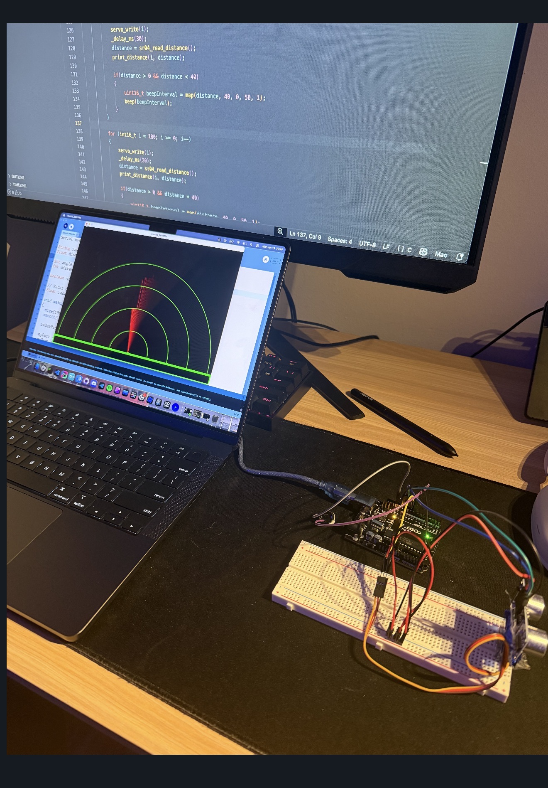

# Uno R3 Radar 🛰️

A bare-metal ultrasonic radar for the [Elegoo UNO R3](https://www.elegoo.com/) (ATmega328P), with a sweep-line GUI on the computer. Everything on the microcontroller is written in plain C against the AVR registers — **no Arduino libraries**.



## What is this?

A small sonar/radar that sweeps an **HC-SR04 ultrasonic sensor** across 180° using a **servo motor**, measures the distance at each angle, and streams the results to a computer over serial. A desktop GUI draws a classic radar sweep, and anything detected closer than 40 cm lights up in red and makes an onboard **buzzer** beep — faster the closer the object gets.

| | |
|---|---|
| **Microcontroller** | Elegoo UNO R3 (ATmega328P @ 16 MHz) |
| **Sensor** | HC-SR04 ultrasonic distance sensor |
| **Actuator** | 9 g servo (sweeps 0–180°) |
| **Output** | Buzzer + serial stream to a GUI |
| **Firmware** | Bare-metal AVR C (`avr-gcc`, `avr-libc`) |
| **GUI** | SDL2 (C), originally Processing (Java) |

## Hardware

### Wiring

The firmware drives the ATmega328P registers directly, so the pins below are the physical port/pin names rather than `digitalWrite()` numbers.

| Signal | ATmega328P pin | Arduino pin | Notes |
|---|---|---|---|
| Servo signal | `PB1` | 9 | Timer1 output compare `OC1A`, 50 Hz PWM |
| Ultrasonic trigger | `PB4` | 12 | Output |
| Ultrasonic echo | `PB3` | 11 | Input |
| Buzzer | `PB0` | 8 | Output |
| Serial TX | — | 1 | UART @ 9600 baud to the computer |

> The serial device name is hardcoded for macOS (`/dev/cu.usbmodem…`) in a couple of places — see [Build & run](#build--run) below.

## Repository layout

```
uno-r3-radar/
├── main.c          # Bare-metal AVR firmware (servo, HC-SR04, buzzer, serial)
├── main.java       # Original Processing GUI (kept for reference / history)
├── Makefile        # Builds & flashes the firmware
├── gui/
│   ├── gui.c       # Current SDL2 radar GUI
│   └── Makefile    # Builds the SDL2 GUI
├── IMG_2549.jpg    # Photo of the setup (shown at the top)
└── README.md
```

## Firmware (`main.c`)

`main.c` is the reason this project exists: it does **not** use the Arduino core libraries. It sets registers directly through `avr/io.h`:

- **Servo** — Timer1 in fast PWM mode with `ICR1` as TOP, producing a clean 50 Hz signal with a 1–2 ms pulse for 0–180°.
- **HC-SR04** — bit-bangs the trigger pulse and times the echo return to compute distance in cm.
- **Buzzer** — beeps for objects under 40 cm; the beep interval maps to distance so it gets faster as an object approaches.
- **Serial** — minimal UART driver that streams one reading per degree as:

```
angle,distance.
```

The servo sweeps 0° → 180° and back forever, reading and reporting the distance at every step.

## GUI

### SDL2 GUI (`gui/gui.c`) — current

A C program using SDL2 that:

- Opens a 1080×720 window and reads the serial stream.
- Draws the radar rings, a sweeping green line, and a red line toward any detected object.
- Fades old sweep positions to leave the classic "trail" effect.
- Quits on <kbd>Esc</kbd> or when the window is closed.

### Processing GUI (`main.java`) — original

The very first version of the GUI was written in **Processing (Java)** and used the `processing.serial` library to talk to the board. It draws the same radar-style sweep. This file is kept in the repo to show where the project started.

## Project history

This project evolved in two steps:

1. **Started with Arduino libraries + Processing.** The first version used the Arduino core libraries on the board and a Processing sketch (`main.java`) as the GUI — that's why the Java file is still here.
2. **Ported to bare metal.** The firmware was rewritten in plain AVR C so it no longer depends on the Arduino libraries, and the GUI was later replaced with an SDL2 program in C.

## Build & run

### Firmware

Requires `avr-gcc`, `avr-libc`, `avr-binutils`, and `avrdude`.

```sh
make            # produces main.hex
make flash      # flashes via avrdude
```

Update the `-P` device in the `flash` target of the [`Makefile`](Makefile) to match your machine's serial port.

### GUI (SDL2)

```sh
cd gui
make            # build the radar GUI
./radar         # run it (edit the serial port in gui.c if needed)
```

Dependencies: SDL2 and SDL2_ttf (via `pkg-config`). See `make help` / `make check-deps` in `gui/` for the install targets.

## Serial protocol

The board streams text over UART at **9600 baud**. Each frame is:

```
<angle>,<distance>.
```

- `<angle>` — servo angle in degrees (0–180)
- `<distance>` — measured distance in cm (0 means no reading)
- `.` — frame terminator

The GUI buffers on `.`, then parses the two integers.

## Transparency & AI usage

- The **SDL2 GUI** (`gui/gui.c`) was written partly with AI assistance, at a time when the author was still getting to grips with SDL2 — so parts of it may be a little rough around the edges.
- This **README** was also written with AI assistance.

Everything else — the bare-metal firmware, the original Processing sketch, and the overall design — is the author's own work.

## License

No license has been chosen yet. If you plan to make this repository public, consider adding one (e.g. MIT or GPL).
